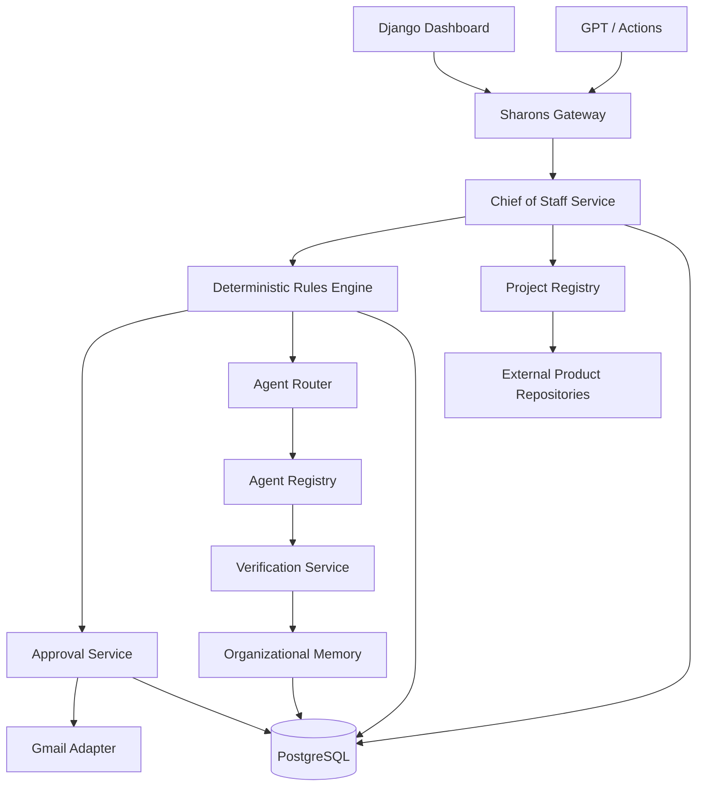
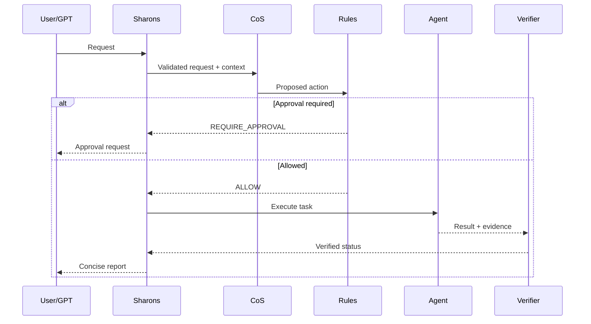

# תוכנית הנדסית — Sharons: מערכת עצמאית לניהול חברת סוכני AI

**גרסה:** 1.0  
**סטטוס:** תוכנית מימוש מוצעת  
**בסיס מחייב:** `CHIEF_OF_STAFF_SPEC_HE.md`  
**אופק:** 90 יום

---

## 1. החלטות ארכיטקטוניות מאושרות

| נושא | החלטה |
|---|---|
| מוצר־על | מפעל לפיתוח פרויקטים משתנים |
| Backend | Django; לוגיקה בצד השרת |
| Frontend | Django templates ללא React; תצוגה ואיסוף קלט בלבד |
| Database | PostgreSQL מהיום הראשון |
| מערכת | Sharons היא מערכת עצמאית ואינה חלק מ־Compass |
| מוצרים | Compass, Mental Trainer ופרויקטים עתידיים נשארים repositories נפרדים |
| Gateway | Sharons הוא שער הכניסה, הזיכרון והתזמור הארגוני |
| Rules | מנוע דטרמיניסטי; LLM אינו אוכף הרשאות |
| אישורי מנכ״ל | Gmail ובמקביל רישום בדשבורד |
| Rules Engine — תהליך ראשון | חשבוניות, קבלות וסיווג הוצאות |
| Rules Engine — תהליך שני | דוא״ל נכנס אל משימה, תיוק או הסלמה |
| סף העברת משאבים | מעל 20% מזמן הצוות השבועי דורש אישור |
| הפעלת חוק | לפחות 30 מקרי אמת, מהם 5 חריגים; יעד דיוק 90% |
| סיווג מידע | ציבורי, פנימי, סודי, אישי־רגיש |
| סליקה | נדחית עד בשלות; Mock ו־adapter בינתיים |

---

## 2. עקרונות תכנון

1. Sharons מוקם כ־repository עצמאי וחדש; אין למקמו בתוך Compass.
2. כל שינוי state מבוצע ב־service layer בתוך transaction.
3. ה־views דקים; אין לוגיקה עסקית בתבניות או JavaScript.
4. כל פעולה משנה מצב דורשת `idempotency_key` ו־`correlation_id`.
5. כל החלטת Rules Engine דטרמיניסטית וניתנת לשחזור.
6. משימות רקע אינן מקור אמת; PostgreSQL הוא מקור האמת.
7. Outbox pattern מונע מצב שבו DB עודכן אך דוא״ל/אירוע לא נשלח.
8. כל מעבר מצב עובר validation והרשאות בצד השרת.
9. אין יצירת subtask או step עם טקסט ריק.
10. כל אינטגרציה חיצונית נמצאת מאחורי adapter.
11. Sharons מחזיק metadata, יעדים, משימות והרשאות של פרויקט; הוא אינו מחזיק את קוד המקור או מסד הנתונים העסקי של המוצר.
12. כל פרויקט מחובר דרך Project Registry ו־adapter בעל capabilities והרשאות מפורשות.

---

## 3. תרשים רכיבים



### אחריות הרכיבים

- **Sharons Gateway:** אימות, correlation, routing וטעינת הקשר מינימלי.
- **CoS Service:** תכנון, תעדוף, יצירת משימות, הקצאה והסלמה.
- **Rules Engine:** הערכת אירוע/פעולה לפי חוק פעיל בלבד.
- **Approval Service:** יצירה, תפוגה והכרעה של בקשות אישור.
- **Agent Router:** בחירת סוכן מורשה לפי registry.
- **Verification Service:** בדיקת תוצר מול acceptance criteria וראיות.
- **Memory Service:** החלטות, לקחים, תוצרים וקשרים; לא היסטוריית צ׳אט גולמית כברירת מחדל.
- **Adapters:** Gmail, סליקה עתידית, אחסון ויישומים חיצוניים.
- **Project Registry:** רשימת הפרויקטים, repositories, environments, owners, capabilities והרשאות; אינו מעתיק את קוד המוצר.

---

## 4. מבנה קוד מוצע

זהו מבנה היעד הראשוני לפרויקט חדש. Codex יקים תחילה שלד מינימלי בלבד לאחר Phase 0 ואישור:

```text
sharons/
├── manage.py
├── sharons/
│   ├── settings.py
│   ├── urls.py
│   ├── wsgi.py
│   └── asgi.py
├── core/
│   ├── admin.py
│   ├── apps.py
│   ├── models.py
│   ├── services.py
│   ├── urls.py
│   ├── views.py
│   ├── auth.py
│   ├── permissions.py
│   ├── events.py
│   ├── memory.py
│   ├── routing.py
│   └── tests/
├── portfolio/
│   ├── models.py
│   ├── services.py
│   ├── views.py
│   ├── urls.py
│   └── tests/
├── agents/
│   ├── base.py
│   ├── registry.py
│   ├── mail_manager.py
│   ├── self_manage.py
│   ├── task_commander.py
│   ├── administrative_agent.py
│   ├── assessment.py
│   ├── chief_of_staff.py              # NEW
│   ├── verifier.py                    # NEW
│   └── research/
│       ├── manager.py                 # NEW
│       ├── planner.py                 # NEW
│       ├── executor.py                # NEW
│       └── evidence.py                # NEW
├── governance/                        # NEW Django app
│   ├── models.py
│   ├── services/
│   │   ├── rules.py
│   │   ├── approvals.py
│   │   ├── authorization.py
│   │   └── audit.py
│   ├── schemas/
│   │   ├── rule.schema.json
│   │   └── event.schema.json
│   ├── views.py
│   ├── urls.py
│   └── tests/
├── operations/                        # NEW Django app
│   ├── models.py
│   ├── services/
│   │   ├── planning.py
│   │   ├── prioritization.py
│   │   ├── assignment.py
│   │   └── verification.py
│   ├── views.py
│   ├── urls.py
│   └── tests/
├── integrations/                      # NEW
│   ├── gmail/
│   │   ├── client.py
│   │   ├── parser.py
│   │   └── webhooks.py
│   ├── payments/
│   │   ├── base.py
│   │   ├── mock.py
│   │   └── models.py
│   └── tests/
├── templates/
│   ├── dashboard/
│   ├── approvals/
│   ├── objectives/
│   ├── tasks/
│   └── rules/
└── static/
```

### גבול repository

- `sharons` מכיל את מערכת ההפעלה הארגונית בלבד.
- `mental-trainer`, ‏`compass` וכל מוצר עתידי נשארים repositories עצמאיים.
- Sharons שומר כתובת repository, branch/default revision, owner, environments ויכולות connector.
- גישה לקוד, issues, CI או deployment ניתנת לכל פרויקט ולכל פעולה בנפרד.
- ברירת המחדל היא read-only; כתיבה, merge, deployment או שינוי production דורשים אישור מתאים.

---

## 5. מודל הנתונים ב־PostgreSQL

### 5.1 Strategy and Objectives

#### `Project`

- `id: UUID`
- `slug: unique`
- `name`
- `description`
- `status: IDEA | DISCOVERY | ACTIVE | PAUSED | ARCHIVED`
- `repository_provider`
- `repository_reference`
- `default_branch`
- `owner`
- `data_classification`
- `metadata: JSONB`

#### `ProjectConnection`

- `project: FK`
- `connection_type: REPOSITORY | ISSUE_TRACKER | CI | DEPLOYMENT | PRODUCT_API`
- `adapter_type`
- `capabilities: JSONB`
- `permission_mode: READ_ONLY | PROPOSE_CHANGES | WRITE_APPROVED`
- `credential_reference` — הפניה לסוד, לא הסוד עצמו
- `active`

כל פעולה דרך connection עוברת Rules Engine ו־audit.

#### `StrategyVersion`

- `id: UUID`
- `version: positive int`
- `title`
- `content: JSONB`
- `status: DRAFT | ACTIVE | SUPERSEDED`
- `approved_by`
- `approved_at`
- `valid_from`, `valid_until`

אילוץ: גרסה פעילה אחת בלבד לכל תקופה.

#### `Objective`

- `id: UUID`
- `code: O1..On`
- `strategy_version: FK`
- `name`
- `business_outcome`
- `due_at`
- `status`
- `owner_agent_id`
- `weight`

#### `KeyResult`

- `objective: FK`
- `description`
- `metric_type`
- `baseline`, `target`, `current_value`
- `evidence_required: bool`
- `status`

### 5.2 Planning and Tasks

#### `Plan`

- `id`, `objective`, `name`, `version`
- `status: DRAFT | PENDING_APPROVAL | ACTIVE | CLOSED`
- `assumptions: JSONB`
- `risks: JSONB`
- `created_by`, `approved_by`
- `expected_version`

#### `Task`

- `id`, `plan`, `parent_task`
- `title`, `business_outcome`
- `scope: JSONB`, `non_goals: JSONB`
- `owner_agent_id`, `contributors: JSONB`
- `status`
- `risk_level`
- `due_at`
- `priority_score: Decimal`
- ששת רכיבי התעדוף כשדות נפרדים
- `approval_policy_id`
- `version`

אילוצים:

- `title` לאחר trim אינו ריק.
- `owner_agent_id` יחיד לפני `ASSIGNED`.
- `acceptance_criteria` אחד לפחות לפני `ASSIGNED`.
- מעבר סטטוס נעשה רק דרך service.

#### `AcceptanceCriterion`

- `task: FK`
- `description`
- `criterion_type: MANUAL | AUTOMATED | EVIDENCE`
- `required: bool`
- `status: PENDING | PASSED | FAILED`
- `verified_by`, `verified_at`

#### `Dependency`

- `predecessor_task`, `successor_task`
- `type: BLOCKS | REQUIRES | INFORMS`

אילוץ: מניעת self-reference ובדיקת cycle בשירות.

### 5.3 Agents and Runs

#### `AgentDefinition`

- `agent_id: unique`
- `role`, `capabilities: JSONB`, `tools: JSONB`
- `allowed_data_classes: JSONB`
- `forbidden_actions: JSONB`
- `max_risk_level`
- `max_concurrent_tasks`
- `reliability_score`
- `prompt_version`
- `active`

#### `AgentRun`

- `id`, `task`, `agent_id`
- `attempt_number`
- `status`
- `input_snapshot: JSONB`
- `output: JSONB`
- `token_or_cost_metadata: JSONB`
- `started_at`, `completed_at`
- `correlation_id`

אילוץ: לכל משימה עד שני ניסיונות אוטומטיים.

#### `Evidence`

- `task`, `agent_run`
- `kind: TEST | SOURCE | ARTIFACT | HUMAN_CONFIRMATION`
- `uri_or_reference`
- `checksum`
- `metadata: JSONB`
- `verified: bool`

### 5.4 Governance

#### `Rule`

- `rule_id`, `version`
- `name`, `owner`
- `status`
- `trigger: JSONB`
- `conditions: JSONB`
- `decision_table: JSONB`
- `exceptions: JSONB`
- `execution: JSONB`
- `schema_version`
- `approved_by`, `approved_at`
- `valid_from`, `expires_at`

אילוצים:

- unique (`rule_id`, `version`).
- גרסה פעילה אחת לכל `rule_id`.
- JSON Schema validation לפני `VALIDATED`.
- אין עריכת payload לאחר `ACTIVE`; יוצרים גרסה חדשה.

#### `RuleTestCase`

- `rule: FK`
- `name`
- `input_event: JSONB`
- `expected_decision`
- `actual_decision`
- `is_exception_case`
- `passed`

#### `RuleEvaluation`

- `event_id`, `rule`, `decision`
- `matched_paths: JSONB`
- `reason_codes: JSONB`
- `input_snapshot_hash`
- `evaluated_at`

#### `ApprovalRequest`

- `id`, `subject_type`, `subject_id`, `subject_version`
- `action_payload_hash`
- `risk_level`, `summary`, `options: JSONB`
- `recommendation: JSONB`
- `status: PENDING | APPROVED | REJECTED | CHANGES_REQUESTED | EXPIRED`
- `requested_at`, `expires_at`, `decided_at`
- `decided_by`, `decision_note`

אילוץ: אישור תקף רק ל־subject version ול־payload hash שנשלחו.

#### `AuditEvent`

- `id: UUID`
- `occurred_at`
- `actor_type`, `actor_id`
- `action`
- `object_type`, `object_id`
- `before_hash`, `after_hash`
- `correlation_id`, `causation_id`
- `metadata: JSONB`

הטבלה append-only דרך הרשאות DB ושירות ייעודי.

### 5.5 Organizational Memory

#### `MemoryRecord`

- `id`, `record_type`
- `title`, `content: JSONB`
- `source_type`, `source_id`
- `owner`
- `classification: PUBLIC | INTERNAL | CONFIDENTIAL | PERSONAL_SENSITIVE`
- `verification_status`
- `version`
- `valid_from`, `valid_until`
- `supersedes: self FK`
- `embedding_reference` אופציונלי; אינו מקור אמת

### 5.6 Integrations and Delivery

#### `OutboxMessage`

- `topic`, `payload: JSONB`
- `status: PENDING | SENT | FAILED`
- `attempts`, `next_attempt_at`
- `idempotency_key: unique`

#### `InboxEvent`

- `source`, `external_event_id`
- `payload: JSONB`
- `received_at`, `processed_at`
- `status`

אילוץ: unique (`source`, `external_event_id`).

---

## 6. ממשקי שירות פנימיים

```python
class ChiefOfStaffService:
    def intake_request(self, request, actor, correlation_id): ...
    def build_plan(self, objective_id, context): ...
    def prioritize(self, task_candidates): ...
    def assign(self, task_id, agent_id, expected_version): ...
    def review_progress(self, objective_id): ...
    def escalate(self, subject, reason_code): ...

class RulesEngine:
    def evaluate(self, event, proposed_action, active_rules): ...
    def validate_rule(self, rule_payload): ...
    def run_test_suite(self, rule_version): ...

class ApprovalService:
    def request(self, subject, action_payload, expires_at): ...
    def decide(self, approval_id, decision, actor, expected_version): ...
    def validate_for_execution(self, approval_id, action_payload): ...

class VerificationService:
    def verify_task(self, task_id): ...
    def record_criterion_result(self, criterion_id, evidence): ...

class PaymentProvider:
    def create_customer(self, customer): ...
    def create_subscription(self, customer_id, plan_id): ...
    def cancel_subscription(self, subscription_id): ...
    def refund(self, transaction_id, amount): ...
    def verify_webhook(self, request): ...
```

כל המימושים מחזירים DTO מובנה; אין להעביר exceptions גולמיים למודל שפה או לממשק.

---

## 7. API v1

כל endpoint משנה מצב מקבל:

- Header `Idempotency-Key`
- Header `X-Correlation-ID`, או יוצר אחד ומחזירו
- `expected_version` בגוף כאשר מעדכנים entity קיים

### 7.1 Objectives and Plans

| Method | Path | תפקיד |
|---|---|---|
| GET | `/api/v1/objectives/` | מצב היעדים |
| GET | `/api/v1/objectives/{id}/critical-path/` | נתיב קריטי |
| POST | `/api/v1/plans/` | יצירת תוכנית |
| POST | `/api/v1/plans/{id}/submit/` | העברה לאישור אם נדרש |

### 7.1A Portfolio

| Method | Path | תפקיד |
|---|---|---|
| GET | `/api/v1/projects/` | רשימת פרויקטים |
| POST | `/api/v1/projects/` | רישום פרויקט חדש |
| GET | `/api/v1/projects/{id}/` | מצב, יעדים וחיבורים |
| POST | `/api/v1/projects/{id}/connections/` | הצעת חיבור לפרויקט |
| POST | `/api/v1/projects/{id}/actions/` | הצעת פעולה דרך adapter ו־Rules Engine |

### 7.2 Tasks

| Method | Path | תפקיד |
|---|---|---|
| POST | `/api/v1/tasks/upsert/` | יצירה או עדכון בטוח |
| POST | `/api/v1/tasks/{id}/assign/` | הקצאת סוכן |
| POST | `/api/v1/tasks/{id}/transition/` | מעבר מצב |
| POST | `/api/v1/tasks/{id}/evidence/` | צירוף ראיה |
| POST | `/api/v1/tasks/{id}/verify/` | אימות עצמאי |

### 7.3 CoS and Agents

| Method | Path | תפקיד |
|---|---|---|
| POST | `/api/v1/cos/intake/` | קליטת בקשה |
| POST | `/api/v1/cos/plan/` | יצירת תוכנית |
| GET | `/api/v1/agents/` | Registry מסונן בהרשאה |
| POST | `/api/v1/agents/invoke/` | הפעלה לאחר gate |
| GET | `/api/v1/agents/{id}/performance/` | אמינות וביצועים |

### 7.4 Rules and Approvals

| Method | Path | תפקיד |
|---|---|---|
| POST | `/api/v1/rules/events/` | קליטת אירוע |
| POST | `/api/v1/rules/evaluate/` | הערכה דטרמיניסטית |
| POST | `/api/v1/rules/proposals/` | טיוטת חוק מראיון |
| POST | `/api/v1/rules/{id}/validate/` | schema validation |
| POST | `/api/v1/rules/{id}/test/` | suite בדיקות |
| POST | `/api/v1/rules/{id}/activate/` | דורש אישור |
| GET | `/api/v1/approvals/` | תיבת החלטות |
| POST | `/api/v1/approvals/{id}/decision/` | החלטת משה |

### 7.5 Memory and Reports

- `POST /api/v1/history/search/`
- `POST /api/v1/events/`
- `POST /api/v1/conversation/finalize/`
- `GET /api/v1/reports/weekly/`
- `GET /api/v1/audit/`

---

## 8. זרימות הליבה

### 8.1 אירוע כללי



### 8.2 חשבונית או קבלה

1. Gmail adapter קולט metadata וקובץ מצורף.
2. נשמר `InboxEvent`; כפילות נעצרת לפי external id ובדיקת fingerprint.
3. extractor מפיק ספק, מספר מסמך, תאריך, סכום, מטבע ומע״מ.
4. Confidence נמוך או שדה חסר → `NEEDS_MORE_DATA`.
5. Rules Engine מסווג הוצאה ומחליט: טיוטה, תיוק, אישור או בדיקה ידנית.
6. אין תשלום אוטומטי.
7. לאחר אישור, נוצרה רשומה פיננסית ו־audit event.
8. סוף חודש: reconciliation מול מקור הבנק/כרטיס.

### 8.3 דוא״ל נכנס

1. קליטה ונטרול HTML/קבצים מסוכנים.
2. prompt injection boundary: תוכן ההודעה הוא data בלבד.
3. סיווג: מידע, משימה, בקשת החלטה, חשבונית, ספאם או אישי־רגיש.
4. יצירת draft action בלבד.
5. פנייה לאדם או שליחה דורשת אישור משה.
6. תיוק פנימי בסיכון נמוך יכול להיות `ALLOW_AND_NOTIFY`.
7. משימה נוצרת רק עם title, owner, due policy ו־acceptance criterion.

### 8.4 אישור דרך Gmail

1. Approval Service יוצר בקשה וקישור חתום קצר־חיים לדשבורד.
2. Outbox שולח דוא״ל המסכם עובדות, אפשרויות, המלצה וסיכון.
3. לחיצה מובילה לדשבורד מאומת; אין לאשר רק באמצעות טקסט תשובה חופשי בשלב הראשון.
4. ההחלטה נרשמת ב־PostgreSQL וב־audit log.
5. המבצע בודק מחדש version, hash ותפוגה לפני פעולה.

החלטה זו מונעת זיוף או פרשנות שגויה של תשובת מייל.

### 8.5 סליקה מדומה

- `MockPaymentProvider` מדמה הצלחה, סירוב, timeout, ביטול, refund ו־webhook כפול.
- אין שמירת מספרי כרטיס.
- חוזה ה־adapter נשאר יציב; בחירת ספק אמיתי נדחית עד לפני בטא בתשלום.
- לפני בחירת ספק ייבדקו לפחות שלושה ספקים ישראליים מול החוזה.

---

## 9. מנוע החוקים

### 9.1 Interpreter מצומצם

בגרסה הראשונה נתמכים רק:

- קומבינטורים: `all`, `any`, `not`
- אופרטורים: `equals`, `not_equals`, `less_than`, `less_or_equal`, `greater_than`, `greater_or_equal`, `in`, `not_in`, `exists`
- טיפוסים: string, number, boolean, date, enum

אין `eval`, אין Python מתוך JSON ואין ביטויי טקסט חופשיים.

### 9.2 סדר הערכה

1. schema validation.
2. איתור rules פעילים לפי trigger.
3. exceptions לפני decision table.
4. first explicit match לפי priority.
5. ללא התאמה: `NEEDS_MORE_DATA` או fallback מפורש; לעולם לא `ALLOW` משתמע.
6. שמירת `matched_paths` ו־reason codes.

### 9.3 שער הפעלה

חוק לא יעבור ל־`ACTIVE` אלא אם:

- JSON תקין.
- אין אופרטור לא נתמך.
- כל הבדיקות הסינתטיות עברו.
- נבדקו 30 מקרי אמת לפחות, מהם 5 חריגים.
- לפחות 90% מההמלצות אושרו ללא עריכה.
- אין false allow בפעולה בסיכון גבוה.
- משה אישר את הגרסה.

הערה ביקורתית: 90% מתוך 30 הוא אות ראשוני, לא הוכחה סטטיסטית חזקה. לכן ההפעלה הראשונה היא הדרגתית, וכל פעולה חיצונית ממשיכה לדרוש אישור.

---

## 10. הרשאות וסיווג מידע

| סיווג | דוגמאות | גישה |
|---|---|---|
| ציבורי | אתר, חומר שיווקי שפורסם | סוכנים מורשים כלליים |
| פנימי | תוכניות, backlog, טיוטות | צוות הפרויקט |
| סודי | כספים, אסטרטגיה, credentials metadata | תפקידים מוגדרים בלבד |
| אישי־רגיש | מידע רפואי, משפחתי, מזהים אישיים | allowlist מפורש, audit מלא |

### כללים

- Classification נבדק לפני שליחת context לסוכן.
- סוכן מקבל רק את השדות הנחוצים למשימה.
- סודות טכניים נטענים בזמן ריצה ואינם נשמרים ב־prompt או AgentRun.
- הורדת סיווג דורשת אישור אנושי.
- כל גישה ל־`PERSONAL_SENSITIVE` נרשמת.

---

## 11. משימות רקע ואמינות

### הצעה

להשתמש בתור עבודה אמין עבור:

- שליחת דוא״ל.
- עיבוד attachment.
- הפעלת סוכן ממושכת.
- דוחות מתוזמנים.
- retries מבוקרים.

ה־API יוצר רשומה ו־Outbox בתוך transaction אחד. Worker שולח או מפעיל אחרי commit. אם worker נופל, ההודעה נשארת `PENDING`.

בחירת מנגנון התור המדויק היא החלטת מימוש משנית; חוזה ה־Outbox אינו תלוי בו.

### Retry policy

- תקלת רשת: exponential backoff עם jitter.
- שגיאת validation או הרשאה: ללא retry.
- לכל AgentRun עד שני ניסיונות אוטומטיים.
- dead-letter state לאחר מיצוי ניסיונות.

---

## 12. Dashboard ללא React

### מסכים ראשונים

1. **Executive Overview:** ארבעת היעדים, סטטוס, נתיב קריטי והחלטות נדרשות.
2. **Approvals Inbox:** ממתינות, תפוגה, סיכון, המלצה והיסטוריה.
3. **Tasks Board:** סינון לפי יעד, owner, status וסיכון.
4. **Rules:** גרסאות, תוצאות בדיקה, shadow/active ודיוק.
5. **Agents:** יכולות, עומס, reliability והרשאות.
6. **Finance:** תזרים, פערי reconciliation ו־Unit Economics.
7. **Audit:** חיפוש לפי correlation, actor ו־object.

### כללי UI

- Django forms ו־server-side validation.
- POST/Redirect/GET לאחר mutation.
- CSRF מופעל.
- אין כפתור ביצוע ללא הצגת השפעה ורמת סיכון.
- פעולות הרסניות דורשות מסך אישור נפרד.
- JavaScript אופציונלי לשיפור בלבד; המערכת עובדת בלעדיו.

---

## 13. בדיקות

### Pyramid

- Unit: נוסחת תעדוף, אופרטורי rules, transitions והרשאות.
- Model/DB: constraints, uniqueness ו־transactions.
- Service: approval binding, outbox ו־idempotency.
- Integration: Gmail sandbox/mock, workers ו־agent adapters.
- End-to-end: request עד verified result.

### תרחישים קריטיים

1. אותו Gmail event מגיע פעמיים.
2. אותו invoice מגיע בשני מיילים.
3. Approval מתייחס לגרסה ישנה.
4. Task נשלח ללא title או acceptance criteria.
5. חוק מכיל operator לא נתמך.
6. תוכן מייל מנסה להורות לסוכן לעקוף הרשאה.
7. Worker נופל אחרי עדכון DB ולפני שליחה.
8. Agent מחזיר הצלחה ללא artifact.
9. שני משתמשים מעדכנים אותה משימה.
10. Mock payment שולח webhook כפול ובסדר הפוך.

### Definition of Done לכל story

- migration ו־rollback נבדקו.
- service tests עברו.
- permissions tests עברו.
- audit event נוצר.
- תיעוד API עודכן.
- אין חריגה לא מתועדת מהמבנה שאושר.

---

## 14. Observability

- structured logs עם `correlation_id`, ללא מידע רגיש.
- מדדים: queue latency, rule decisions, approval latency, agent failures, verification pass rate.
- tracing בין Sharons, Rules, Agent ו־Verifier.
- health checks למסד, worker ודוא״ל.
- alerts רק על אירועים בני פעולה: backlog חריג, כשלי שליחה, false allow או deadline בסיכון.

---

## 15. תוכנית מימוש לפי ספרינטים

### Sprint 0 — שבוע 1: Greenfield design ובידוד סיכונים

- אימות שהתיקייה החדשה עצמאית ואינה מקוננת בתוך repository של מוצר.
- מסמכי ADR לגבולות repository ול־Project Registry.
- תכנון PostgreSQL בסביבת development/staging; אין חיבור production.
- baseline שעות ניהול של משה.
- feature flags לרכיבים החדשים.
- הצעת שלד Django מינימלי ו־dependency list.

**יציאה:** המבנה, הגבולות וה־vertical slice מאושרים לפני יצירת השלד.

### Sprint 1 — שבועות 2–3: Core workflow

- Objective, Plan, Task, Criterion, AgentDefinition, AgentRun.
- state machine בשירות.
- idempotency ו־correlation.
- מסכי Objectives ו־Tasks בסיסיים.

**יציאה:** יצירת תוכנית, משימה, הקצאה ומעבר מצבים מקצה לקצה.

### Sprint 2 — שבועות 4–5: Governance

- Rule, RuleTestCase, Evaluation, ApprovalRequest, AuditEvent.
- interpreter מצומצם ו־JSON Schema.
- Approval Inbox.
- Outbox.

**יציאה:** פעולה מותרת/חסומה/דורשת אישור באופן דטרמיניסטי.

### Sprint 3 — שבועות 6–7: Gmail ושני תהליכי הליבה

- Gmail adapter.
- invoice extraction עם confidence וידני fallback.
- email-to-task classifier.
- דוא״ל אישור עם קישור לדשבורד.
- shadow mode.

**יציאה:** שני תהליכים רצים ב־shadow ללא פעולה חיצונית אוטונומית.

### Sprint 4 — שבועות 8–9: Verification וזיכרון

- Evidence, Verification Service ו־MemoryRecord.
- דוח שבועי.
- reliability score ראשוני לסוכנים.
- בדיקות prompt injection וכפילויות.

**יציאה:** אין `COMPLETED` ללא ראיות וקריטריונים שעברו.

### Sprint 5 — שבועות 10–11: Finance ו־operations

- ledger/import בסיסי והתאמת נתונים.
- Unit Economics ל־Mental Trainer.
- SOP registry.
- מדידת הפחתת שעות ניהול.

**יציאה:** דוח פיננסי עקבי ותצוגת חריגות בתוך חמש דקות.

### Sprint 6 — שבועות 12–13: Mental Trainer readiness

- Mock Payment Provider.
- מסע רכישה מדומה מלא.
- חמישה משתמשי בטא חיצוניים.
- תיקון תקלות קריטיות ו־Go/No-Go package.

**יציאה:** מסע מלא עובד; בחירת ספק סליקה הופכת להחלטה נדרשת לפני בטא בתשלום.

---

## 16. סדר ה־Backlog הראשון

### Must

1. PostgreSQL ו־migrations.
2. Task state machine.
3. Project Registry ו־Agent Registry.
4. Rules interpreter ללא `eval`.
5. Approval binding לגרסה ו־payload.
6. Audit log.
7. Outbox/Inbox idempotent.
8. Gmail intake ו־approval link.
9. Verification gate.
10. שני תהליכי shadow.

### Should

1. Dashboard מלא.
2. weekly report.
3. critical path.
4. agent reliability.
5. financial reconciliation.

### Could

1. embeddings לחיפוש זיכרון.
2. גרפים מורכבים.
3. ספק סליקה אמיתי.
4. Frontend עשיר.

### Won't ברבעון זה

- React.
- תשלומים אוטונומיים.
- שליחת מייל חיצוני ללא אישור.
- עשרה מאגרי מחקר במקביל.
- שינוי עצמי של prompts או הרשאות.

---

## 17. Pre-mortem הנדסי

| כשל | סימן מוקדם | מניעה |
|---|---|---|
| `core` הופך ל־God module | services.py גדל ללא גבול | apps תוספתיות וגבולות import |
| בניית תשתית בלי תוצר משתמש | ספרינטים בלי workflow עובד | vertical slice בכל ספרינט |
| Rules Engine אינו דטרמיניסטי | טקסט חופשי בתוך condition | DSL מצומצם ו־schema קשיח |
| אישור אינו קשור לפעולה | action השתנה לאחר המייל | version + payload hash + expiry |
| כפילויות במייל/חשבוניות | שתי משימות לאותו אירוע | Inbox unique key ו־document fingerprint |
| מידע רגיש זולג ל־logs | payload מלא ב־exception | redaction מרכזי ובדיקות |
| worker גורם לאובדן פעולה | DB עודכן אך אירוע לא נשלח | transactional outbox |
| LLM מדווח הצלחה לא אמיתית | output מילולי ללא ראיה | Verification gate קשיח |
| 90% על 30 מקרים מטעה | מעט חריגים אמיתיים | rollout הדרגתי ומעקב לאחר הפעלה |
| Gmail נהיה ערוץ אישור לא בטוח | אישור בטקסט חופשי | מייל מודיע; החלטה בדשבורד מאומת |
| Sharons נצמד למבנה של מוצר יחיד | מודלים ושדות ייחודיים ל־Mental Trainer | Project Registry וחוזי adapter כלליים |
| קוד מוצרים מועתק לתוך Sharons | תיקיות מוצר בתוך repository | repositories נפרדים וחיבור לפי reference |
| Mental Trainer נדחק מפני Sharons | אין בטא עד שבוע 10 | owner וקיבולת מוגנת ל־O1 |

---

## 18. שערי החלטה במהלך המימוש

1. **סוף שבוע 1:** אישור שלד הפרויקט, apps וגבולות Project Registry.
2. **סוף שבוע 3:** אישור חוזי API וה־state machine.
3. **סוף שבוע 5:** אישור UX של בקשת ההחלטה.
4. **סוף שבוע 7:** בחינת תוצאות shadow ראשונות.
5. **סוף שבוע 9:** החלטה אם חוק עומד במדגם ובסף.
6. **לפני בטא בתשלום:** בחירת ספק סליקה ישראלי.

---

## 19. פעולה ראשונה מומלצת

לפני כתיבת feature חדש, לבצע Sprint 0 קצר:

1. ליצור תיקיית/repository `sharons` עצמאית בלבד; לא תחת Compass.
2. להכניס את חבילת ההוראות והמסמכים, בלי קוד מוצר.
3. לנסח ADR לגבולות Sharons מול repositories של מוצרים.
4. לתכנן PostgreSQL ו־Project Registry.
5. להציע שלד Django מינימלי ואת ה־dependencies; להמתין לאישור לפני scaffolding.
6. לאחר אישור ליצור vertical slice ראשון: רישום Project → `POST /cos/intake` → Task draft → audit event, ללא LLM וללא Gmail.

ה־vertical slice הראשון מוכיח שהגבולות, ה־state והביקורת עובדים לפני שמוסיפים סוכנים ואינטגרציות.
